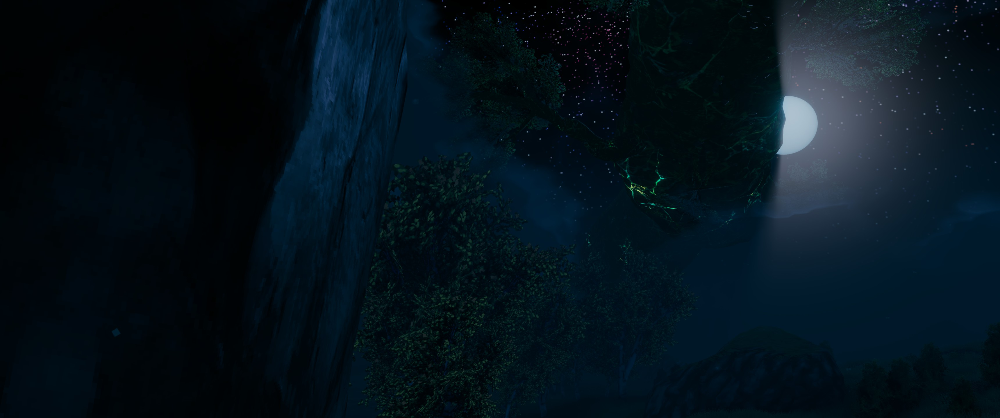

# Wire's Acoustics

**Ray traced sound for Valheim. You hear the room you're in, the walls around you and the world outside.**

In short:

* **Every space sounds like itself.** A stone hall rings, a log cabin sounds warm, a cave sounds like a cave and open ground is dry.
* **Walls finally matter.** The fight outside is muffled until you open the door, and you hear it through the window it really comes through.
* **You know where things are.** Front, back, up and down, not just left and right. Best with headphones.
* **The world gets bigger.** Far sounds arrive late, lose their highs and carry with the wind instead of cutting off after a few metres.
* **Rain, wind and sea stay outside,** and get in through the gaps you left.

Vanilla will sound flat once you go back.

Inspired by [Physically-based audio: why most games sound fake](https://www.youtube.com/watch?v=oN4NZ0sDqKQ) (Voxel Devlog #31). A showcase video is coming later.

## How it works

Rays go out from your character's head in every direction, the way light is traced in a renderer. They find out how big the space is, how closed in, what it's made of and where the openings are. Every sound is then shaped by that and by what stands between it and you.

Which way a sound is comes from the camera, as you see it. How far it is and what's in the way come from your character's head, so zooming out changes nothing.

## Features

* **Reverb from the real space:** worked out from its size, shape and materials. Furniture, rugs and curtains make a room softer, windows and doors let sound out.
* **Walls by material:** stone keeps out more than wood, a grate hardly anything. The next room is muffled, not silent.
* **Sound finds a way:** through windows, doors and roof holes, round corners and over half walls, and it's heard from there. As you step past an edge it changes gradually.
* **Hills, rocks and trees** block sound by their size: a trunk barely matters, a boulder takes the highs off, a hill takes a lot.
* **Distance and air:** natural fading, travel time, Doppler, and air that takes the highs off far sounds, by the weather.
* **Wind:** carries sound downwind, weakens it upwind, gusts and lulls, and drops to a low rumble when you're sheltered.
* **Weather and sea:** rain sounds like the roof above you, the sea comes from the real shoreline, and under water everything above goes quiet.
* **Sounds come from where they're made:** a swing from the weapon, a roar from the head, a chest from its lid, a fire from its flame, crafting from the station. Bigger things sound wider.
* **HRTF (headphones):** how real people's heads and ears change a sound by its direction, for every sound: left and right, front and back, up and down.
* **More sounds at once:** 128 instead of 32, so nothing drops out in a busy base.
* **Extras:** a portal's hum carries through with you, the Mistlands mist no longer lowers the pitch, and the main menu gets the HRTF too.

## Headphones or speakers

Headphones are best. Turn off Windows Sonic and Dolby Atmos while playing: two spatializers at once sound worse. On speakers, turn HRTF off, as your real head already does that part.

## Works with

* **Proximity Voice Chat (Azumatt):** voices come from the speaker's head and get walls, openings and HRTF.
* **Wire's Stackify:** its chest sounds come from each chest.

## Performance

Rays run on worker threads and the sound processing on the audio thread. Sounds too quiet to hear aren't processed, and a room is only scanned again when you move or something in it changes.

## Settings

* **General:** a switch for each part: Room reverb, Realistic distance, Muffling, HRTF, Travel time, Doppler, Under water, Air, Wind, Sound placement, Voice chat, Random loop start.
* **Tuning:** Reverb strength, HRTF strength, Muffling strength, and two advanced ones for how finely a sound's size is sampled.
* **Debug:** Debug log.

Client side only. You can turn the mod off while playing; only the 128 sounds stay until you restart.

## Sources

Wherever I could, the numbers come from measurements and standards instead of being made up:

* **Walls:** the material presets of Valve's [Steam Audio](https://valvesoftware.github.io/steam-audio/doc/capi/scene.html); see-through pieces by how open they are (area-weighted, as ASHRAE does).
* **Edges of walls:** Fresnel knife-edge diffraction ([ITU-R P.526](https://www.itu.int/rec/R-REC-P.526)).
* **Corners, hills and obstacles:** Maekawa's barrier formula as [Kurze and Anderson](https://doi.org/10.1016/0003-682X%2871%2990024-7) wrote it (1971), capped at 20 dB as in [ISO 9613-2](https://www.iso.org/standard/20649.html).
* **Air:** [ISO 9613-1](https://www.iso.org/standard/17426.html), with the climate of [Bergen](https://en.wikipedia.org/wiki/Bergen) and [Finse](https://en.wikipedia.org/wiki/Finse).
* **Wind:** the NCHRP Report 791 results in the [FHWA Noise Measurement Handbook](https://www.fhwa.dot.gov/Environment/noise/measurement/handbook.cfm).
* **Surfaces:** [Sengpiel](https://sengpielaudio.com/calculator-RT60Coeff.htm), the [pyroomacoustics database](https://pyroomacoustics.readthedocs.io/en/stable/pyroomacoustics.materials.database.html), [heyizhou.net](https://heyizhou.net/notes/absorption-coefficients) (steel, and heavy wood from Vorländer); tree bark from [Li et al., 2020](https://doi.org/10.1016/j.apacoust.2020.107328).
* **Ground:** the Nord2000 classes ([d&b NoizCalc white paper](https://www.dbaudio.com/assets/products/downloads/software/noizcalc/dbaudio-noizcalc-technical-white-paper-1.6-en.pdf)) with [Delany and Bazley's model](https://doi.org/10.1016/0003-682X%2870%2990031-9) (1970).
* **Room reverb:** [Sabine's formula](https://sengpielaudio.com/calculator-RT60.htm) and the [critical distance](https://strutt.arup.com/help/Electroacoustics/DCritical.htm).
* **Outside sounds indoors:** checked against [Locher et al., 2018](https://doi.org/10.3390/ijerph15010149).
* **Direction round walls:** the [precedence effect](https://en.wikipedia.org/wiki/Precedence_effect) (Haas 1951, Blauert 1983).
* **HRTF:** the average of 18 real people's measured ears, subjects H3 to H20 of the [SADIE II database](https://www.york.ac.uk/sadie-project/database.html) (Armstrong, Thresh and Kearney, University of York, 2018; [paper](https://doi.org/10.3390/app8112029); Apache License 2.0, included). Turned into a filter and a delay per ear and direction, as [OpenAL Soft](https://openal-soft.org) does. Of the colour both ears hear together only the broad shape is kept (see below), so Valheim still sounds like Valheim.
* **Water:** impedances from [UNSW Physics](https://animations.physics.unsw.edu.au/jw/sound-impedance-intensity.htm).
* **Sea as a line source:** [Hong Kong EPD](https://www.epd.gov.hk/epd/noise_education/web/ENG_EPD_HTML/m1/intro_6.html).

Not from a source (judgement values):

* **Rooms:** heard at half their built size and as furnished homes (Valheim builds are about twice real size and bare), the reverb's loudness and tone, 3 dB softer first reflections and 4 dB darker reverb indoors, how much trees close a space in, what props absorb.
* **Wind:** 12 dB less and down to 800 Hz in the lee of things, gusts up to 4 dB either way, up to 2 dB louder side-on and 3 dB quieter with your back to it, full wind taken as 12 m/s.
* **In the way:** how much soft obstacles muffle, a wall counting once however many pieces it's built from, the two rays 8 cm beside every line, where the mod looks for a way round a wall (up to 5.5 m along it).
* **Distance:** 6 dB more per doubling past the range Valheim gives a sound instead of a cut-off, fires by their range (10 m as full size).
* **Placing:** random bird and insect calls 1 m above whatever is at their spot and not on buildings within 10 m of you (moved out 4 m at a time), your unplaced sounds made placed with a near distance of at least 1 m, a door's sounds 15 cm in from its hinge.
* **HRTF:** how broad that shape is (2 octaves): the narrow peaks and dips of real ears made everything sound like worse headphones.
* **Openings:** how big a gap must be to count as an opening (a 10 cm sphere).

Disclaimer: development is AI assisted. Not fully human or AI.

Donations: [ko-fi.com/krosshair](https://ko-fi.com/krosshair)
