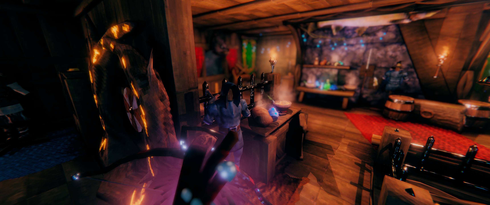

# Wire's Camera Tweaks

**A camera that feels like a lens. Depth of field that blurs like a real one, bloom shaped like real glare, shake that hits without wobbling, and zoom that glides.**

In short:

* **Depth of field like a camera.** Look at something close and what's behind it softens into round bokeh. Look into the distance and nothing blurs.
* **It never gets in your way.** Focus follows what you look at and ignores your own character.
* **Lights glow like they do to your eyes.** A bright core with a soft halo that fades out far across the screen.
* **Shake with weight.** Short hits kick, big events settle into a low rumble instead of a wobble.
* **Smooth zoom.** The mouse wheel glides, and the camera eases back out after a wall pushed it in.

Focus on the table: what's right at the lens melts into the foreground, the room behind it softens, and the bright spots turn into bokeh.

## Features

### Depth of field

Needs Valheim's Depth of Field graphics setting on. Two qualities:

* **Vanilla:** Valheim's blur with smoother focus. Focus moves the same at any frame rate instead of snapping at high FPS and dragging at low.
* **Lens Blur (default):** the way games like Call of Duty do bokeh. Blurred foreground spreads softly over what's behind it, the background never bleeds over something sharp, and bright highlights become round discs.

With Lens Blur:

* **Focus like a real lens:** how blurry something is depends on how much closer or further it is than what you look at, so far views stay crisp and close-ups get depth.
* **Focus from an area,** not a single point, so a branch crossing the centre of the screen doesn't make it jump. Your character is never the focus and never blurs.
* **Near blur** for grass or a branch between the camera and your character.

### Bloom

Needs Valheim's Bloom graphics setting on.

* **Convolution bloom:** bright light spreads in the shape of real glare in the eye (Spencer et al. 1995, "Physically-Based Glare Effects"), across the whole screen. Done with an FFT on the graphics card.
* **Same amount of glow** as Valheim's bloom, from the same bright parts of the picture. Only the shape changes.
* **Lens dirt** still shows, as strong as before.

### Camera shake

* **Weaker overall.** Short impacts keep a punchy kick, bigger events turn into a lower, sustained rumble with subtle secondary motion.
* **Directional impacts:** hits push the camera the way they came from.

### Smooth zoom

* **Mouse wheel and controller zoom glide** to where you asked.
* **After a wall pushes the camera in,** it eases back out instead of snapping.

## Settings

### 3 - Depth of Field

* **Quality:** Vanilla or LensBlur.
* **Aperture:** lens opening in millimetres for Lens Blur. 30 is about a 50 mm f/1.8 photo lens. Higher blurs more.
* **Blur In Time / Clear Time:** how fast focus follows what you look at.
* **Near Blur:** blur things between the camera and your character.

### 4 - Bloom

* **Intensity:** how much light glows. 1 is as much as Valheim's bloom.

Shake and zoom strengths are under **1 - Shake** and **2 - Smooth Zoom**.

## Performance

Lens Blur and the bloom run on the graphics card. Lens Blur is barely measurable on an RTX 4090. On the processor it costs less than Valheim's focus check, which it replaces.

## Compatibility

Works with RenoDX: its HDR highlights make the bokeh brighter, and it tone maps the new bloom like the old one.

Disclaimer: development is AI assisted. Not fully human or AI.

Donations: [ko-fi.com/krosshair](https://ko-fi.com/krosshair)
