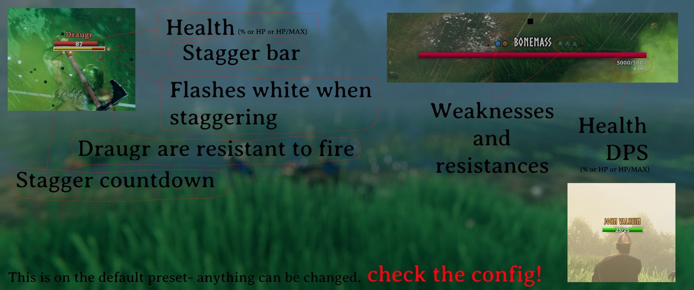
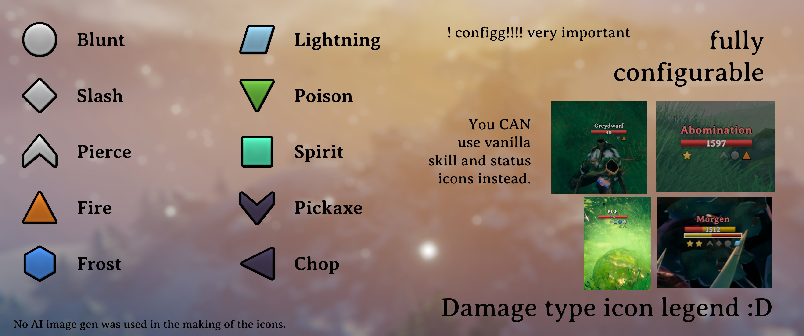
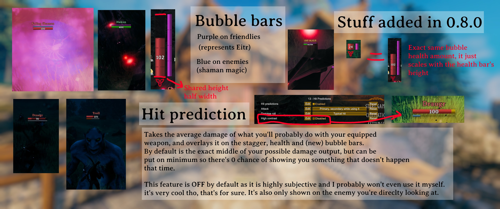
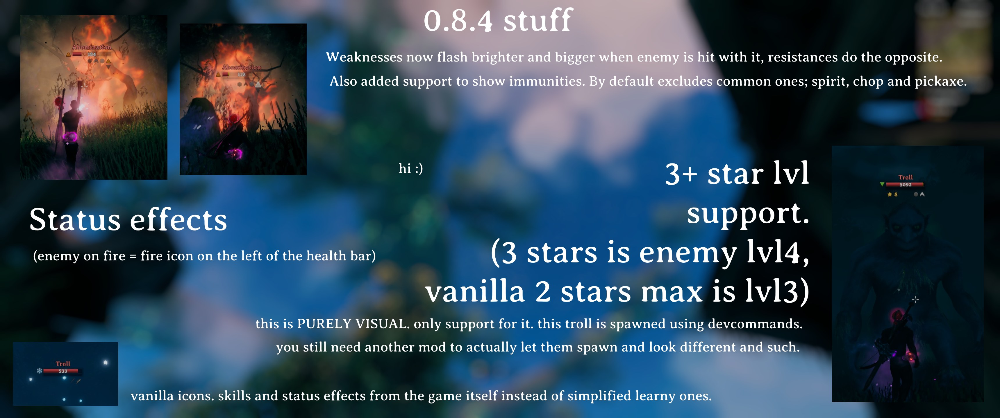
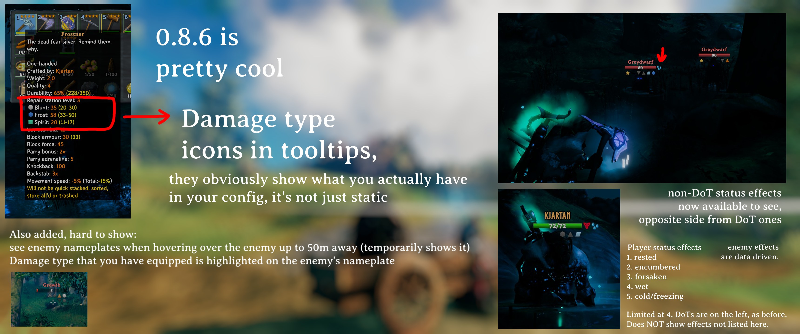

# Wire's Enemy HUD

**Fight smarter.** See what every enemy is weak to, how close it is to staggering and how much health it has left, right on its health bar. Looks like it was always part of Valheim.

The ORIGINAL Valheim 1.0 health bar mod. Works with bosses, other players and modded creatures, and everything can be changed or turned off.

## Know what to hit it with

No more guessing why your weapon barely scratches something. Little icons under each health bar show what the enemy is weak to, then what it resists or doesn't feel at all.

* **Your weapon counts:** the damage types of the weapon in your hand stand out, so you know at a glance if it's a good pick. Or show only those.
* **Hits answer back:** hit a weakness and its icon flashes white and swells. Hit a resistance and it goes dark.
* **Bosses too:** weaknesses left of the name, resistances right of it.
* **Modded creatures just work,** since it's read from the creature itself.
* **On your weapons:** item tooltips show the same icons.

Every shape and color can be changed, or use the icons of Valheim's skills and status effects instead (really not recommended).

## Know when to go all in

* **Stagger bar:** watch it fill up, then break them.
* **Stagger countdown:** a yellow bar drains while the enemy is staggered, which is exactly how long your hits deal double damage.
* **Critical flash:** the bar flashes white when a backstab or a hit on a staggered enemy lands.
* **Bubble bars:** see how much a Staff of Protection or fuling shaman bubble can still take. Yours gets a bar next to your health.

## Know how much is left

* **HP numbers** on creatures, players and bosses: current, current/max or percent.
* **Boss DPS,** so you can see how hard your group is hitting.
* **Hit predictions** (off by default): how much your next hit would take from the enemy you look at, before you swing. It counts resistances, sneak attacks, combo finishers and staggers.

## Know what's happening to it

* **Burning, frozen, shocked, poisoned or hit by spirit:** an icon next to the health bar.
* **Other effects** such as wet, tarred or harpooned show too.
* **Your friends:** see who's rested, freezing, encumbered or waiting on a potion cooldown.
* **Did it see me?** The name changes color when an enemy notices you and when it's hunting you.

## Bars that are there when you need them

* **Bigger:** health bars are twice as thick, with see-through backgrounds.
* **Never lost:** hit or parry something and its bar shows, however far away it is. Look at a creature up to 50 m away and you see it too.
* **Always on screen:** a troll's bar slides along the top edge instead of vanishing above you.
* **Out of the way:** other players' names fade until you aim at them. Enemies can do the same.
* **Three stars and more** (from level mods) show as a count.
* **Friendly creatures** are green.

## Make it yours

Start from the Author's Choice or the Vanilla preset, then change whatever you like in the config.

## Multiplayer

Works alone on your side. Players who have it too share stagger, bubbles, status effects, critical hits and hit responses for the creatures their game runs, and for themselves.

Disclaimer: the code is AI assisted. No AI image generation was used.

Donations: [ko-fi.com/krosshair](https://ko-fi.com/krosshair)
