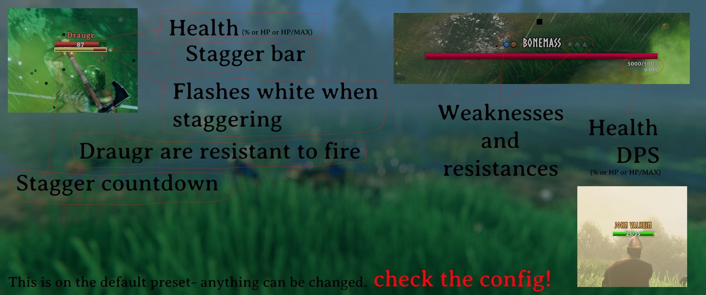
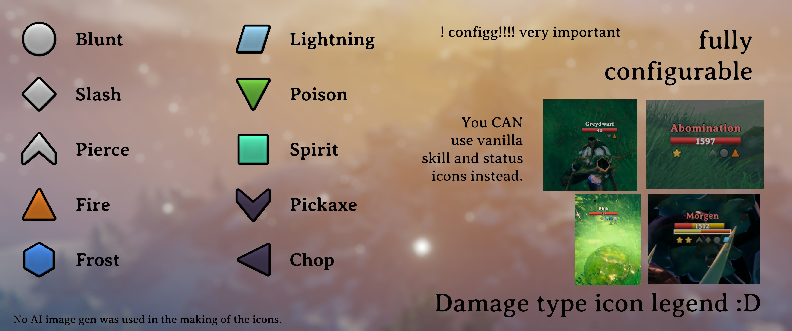
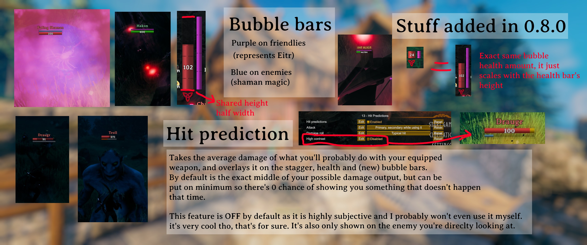
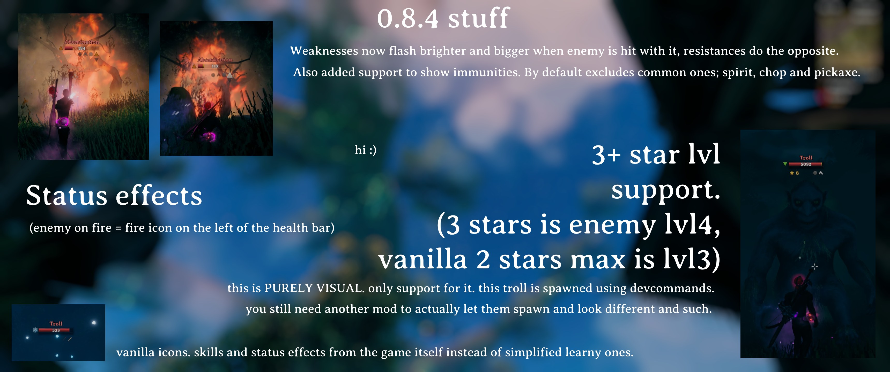
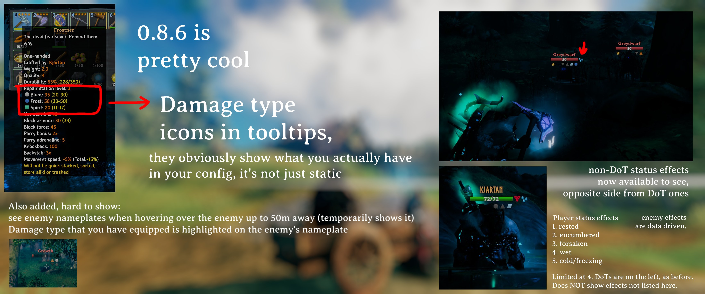

# Wire's Enemy HUD

**Valheim's health bars tell you almost nothing. These tell you how to win the fight.**

* **What hurts it:** its weaknesses and resistances, as little icons under its bar.
* **When to go all in:** a stagger bar, and a countdown of how long your hits deal double damage.
* **How much is left:** HP numbers, and DPS on bosses.
* **What's going on:** burning, poisoned, frozen, shielded, and whether it has noticed you.

All of it in Valheim's style, small enough to stay out of the way, and every bit can be changed or turned off. Works on creatures, bosses, other players and modded creatures.

The ORIGINAL Valheim 1.0 health bar mod.

## Is it for you?

* **You're new:** learn what works on what by playing, without a wiki on your second screen.
* **You like a challenge:** it doesn't change the fight at all, it only lets you plan it. Keep just the parts you want.
* **You play with friends:** see who's rested, freezing or waiting on a potion cooldown, and how hard you're hitting the boss together.
* **You play with mods:** weaknesses are read from the creature, so modded ones work right away. Enemies with three stars or more show their count.
* **You like Valheim the way it is:** pick the Vanilla preset and turn on only what you miss.

## Know what to hit it with

No more guessing why your weapon barely scratches something. Weaknesses come first, in color. Resistances follow in gray, immunities in darker gray.

* **Your weapon counts:** the damage types of the weapon in your hand stand out, so you know at a glance if it's a good pick. Or show only those.
* **Hits answer back:** hit a weakness and its icon flashes white and swells. Hit a resistance and it goes dark.
* **Bosses too:** weaknesses left of the name, resistances right of it.
* **On your weapons:** item tooltips show the same icons, so you learn them quickly.

Every shape and color can be changed, or use the icons of Valheim's skills and status effects instead (really not recommended).

## Know when to go all in

* **Stagger bar:** watch it fill up, then break them.
* **Stagger countdown:** a yellow bar drains while the enemy is staggered, which is exactly how long your hits deal double damage.
* **Critical flash:** the bar flashes white when a backstab or a hit on a staggered enemy lands.
* **Bubble bars:** see how much a Staff of Protection or fuling shaman bubble can still take. Yours gets a bar next to your health.

## Know how much is left

* **HP numbers** on creatures, players and bosses: current, current/max or percent.
* **Boss DPS,** from all the damage the boss takes.
* **Hit predictions** (off by default): how much your next hit would take from the enemy you look at, before you swing. They count resistances, sneak attacks, combo finishers and staggers.

## Know what's going on

* **Burning, frozen, shocked, poisoned or hit by spirit:** an icon next to the health bar.
* **Other effects** such as wet, tarred or harpooned show too.
* **Did it see me?** The name changes color when an enemy notices you and when it's hunting you.
* **Friend or foe:** friendly creatures have green bars.

## Bars that are there when you need them

* **Easier to read:** twice as thick, with see-through backgrounds.
* **There when it matters:** hit or parry something and its bar shows, however far away it is. Look at a creature up to 50 m away and you see it too.
* **Always on screen:** a troll's bar slides along the top edge instead of vanishing above you.
* **Out of the way:** other players' names fade until you aim at them. Enemies can do the same.

## Questions

* **Do others need it?** No. It works with just you. Players who have it too share stagger, bubbles, status effects, critical hits and hit responses for the creatures their game runs, and for themselves.
* **Is it too much?** Start from the Vanilla preset and add what you like. Icons and HP numbers can also show only on what you're looking at, and the rest can fade.
* **Where are the settings?** In the config, or in-game with a configuration manager.

Disclaimer: the code is AI assisted. No AI image generation was used.

Donations: [ko-fi.com/krosshair](https://ko-fi.com/krosshair)
