# Wire's Shadows

Better lighting for Valheim: real shadows for every light you place, more natural shading on every surface and improved ambient occlusion, with optional smooth shading instead of the toon steps, and it runs faster than vanilla.

In vanilla Valheim only the few lights nearest you get shadows, and the game redraws those every frame. Every other sconce and torch shines straight through walls, floors and roofs. Wire's Shadows gives every placed light cached shadows instead, so your base looks right and runs faster than vanilla. On top, every surface is shaded more naturally, and the shade in corners and creases takes light bouncing between surfaces into account.

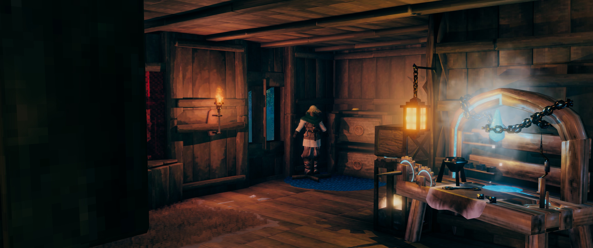

## Features

### Shadows for every light

* **Every placed light casts shadows:** sconces, torches, braziers, hearths, lanterns, forges and the rest. No more light leaking through walls, floors and roofs.
* **Cached:** a light's shadow is drawn once and again only when something near it changes (building, a door opening).
* **Moving shadows** for players, creatures, doors, dropped items and moving machine parts. Only the changed part is redrawn, only where it can be seen.
* **Items on stands, food and meads** cast shadows, and their glows are lights of their own.
* **Ready before the loading screen fades,** so nothing pops in after loading or teleporting.

Each scene with Wire's Shadows first and vanilla second.

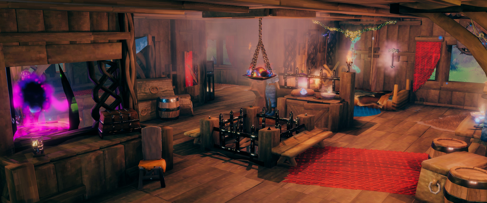
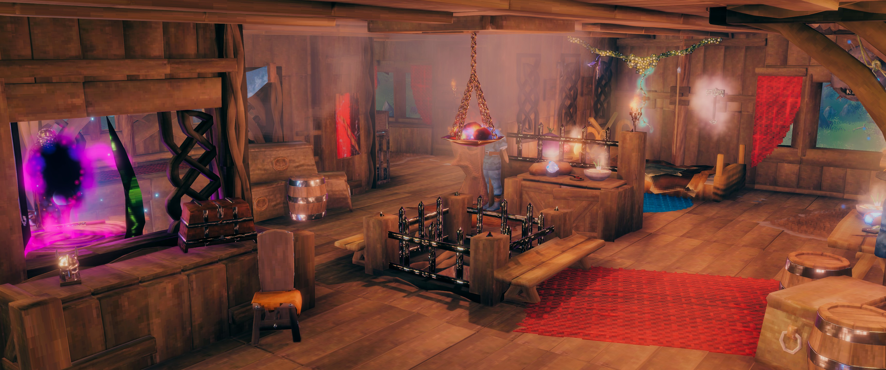

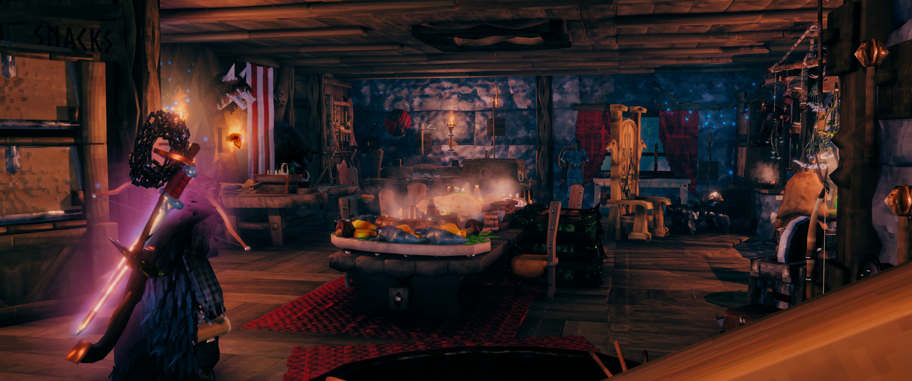
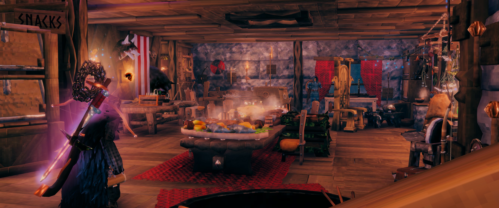

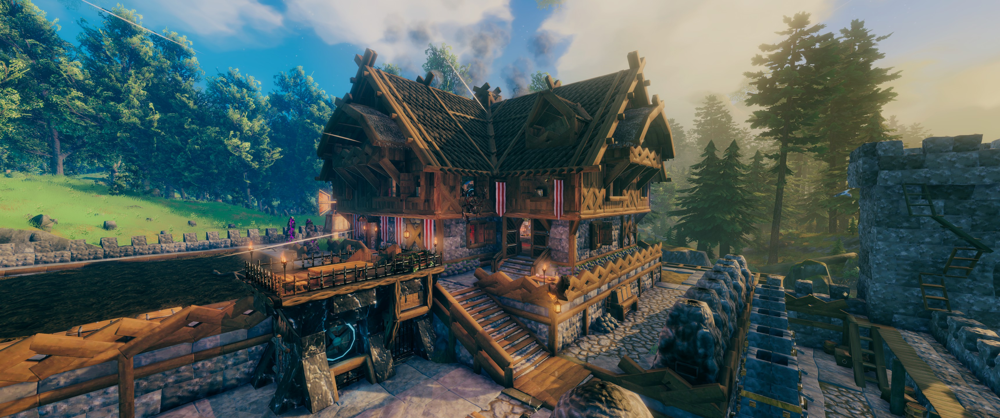
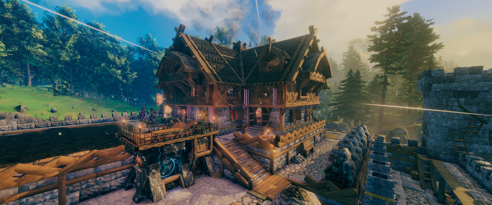

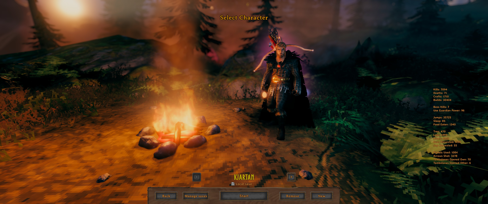
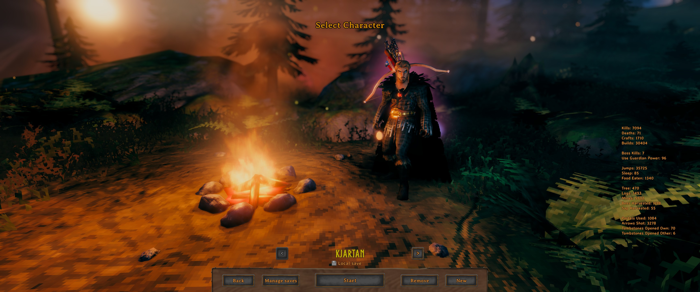

### Enhanced shading: Burley's diffuse

Valheim lights every surface with Lambert's model ([Lambert, 1760](https://en.wikipedia.org/wiki/Lambertian_reflectance)): how bright a surface is depends only on the angle of the light, and it looks the same from every side. Real surfaces don't. A rough one (ground, rock, bark, leaves) looks brighter and flatter when the light is behind you, and a smooth one darkens toward its edges.

The mod uses Burley's diffuse instead ([Burley, Disney, 2012](https://media.disneyanimation.com/uploads/production/publication_asset/48/asset/s2012_pbs_disney_brdf_notes_v3.pdf)), which does both from each surface's roughness and was built to match measured real materials. It's the same model as in Unity's own Standard shader. Lit straight on, it gives exactly what Lambert does.

On, then off (the game's look):

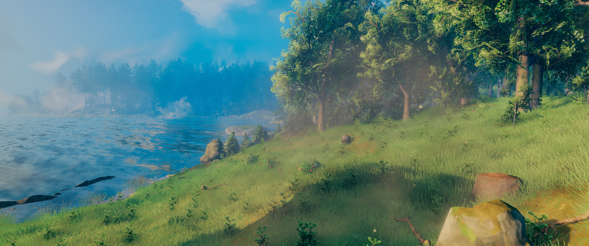
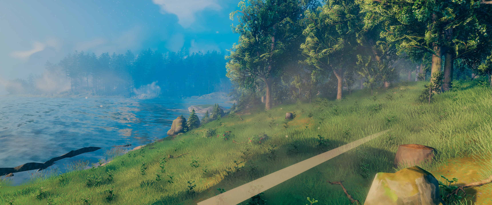

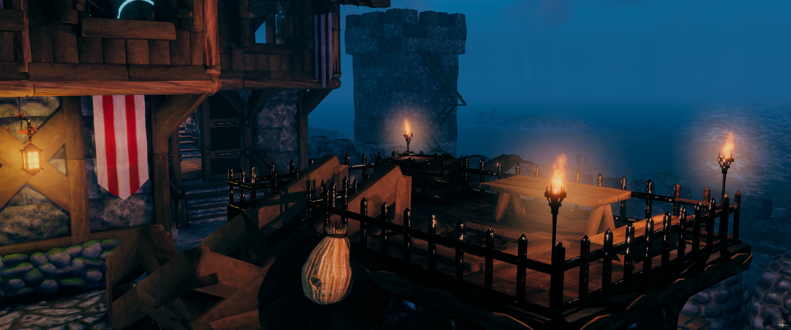

### Improved ambient occlusion: multi-bounce

Valheim's ambient occlusion (Amplify Occlusion, GTAO) darkens corners and creases the same grey everywhere. In reality light bounces around inside a corner and picks up the surface's colour, so bright corners stay lighter and coloured ones keep their colour. The mod adds that bounce, per colour channel from the surface's own colour, with the fit from [Jimenez et al., Activision, 2016](https://blog.selfshadow.com/publications/s2016-shading-course/activision/s2016_pbs_activision_occlusion.pdf). It also runs at full resolution and stays steady from frame to frame.

### Smooth shading (optional)

Off by default. Light fades smoothly from lit to unlit instead of in Valheim's toon steps, the look of Badgers Shading Overhaul, built in.

The game's toon steps, then Smooth shading on:

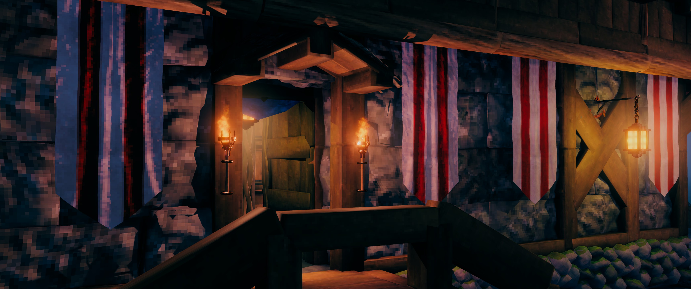

With the Look settings off, the lighting is exactly the game's own.

## Limitations

* **No fire wiggle.** In vanilla a fire's light shakes around a little. A cached shadow is drawn from one spot, so here the light holds still. Its brightness still flickers.
* **No swaying shadows.** Banners, hanging cloth and herbs cast their shadow at rest, not moving with the wind.

## Settings

### General

* **Enabled:** off brings back the game's own lighting and shadows.
* **Shadows:** which placed lights cast shadows. All (default): every one. Performance: only the ones the game itself gives shadows (fires, braziers, hearths, lanterns); sconces, standing torches and the like get none. Off: none. Torches you carry keep the game's own shadows. The game's Point light shadows setting isn't used.

### Look

* **Enhanced shading:** on by default. Burley's diffuse instead of Lambert. Off: the game's look.
* **Smooth shading:** off by default. No toon steps, for the sun, moon and every light. Just as bright overall.
* **Improved AO:** on by default. Multi-bounce ambient occlusion. Off: the game's own.

### Performance

* **Weather lit in one pass:** on by default. Rain, snow, mist and wind dust lit by every nearby light in one draw. Same look.
* **Flicker culling:** on by default. Lights further than the flicker distance, or not lighting anything on screen, stop flickering and hold a steady brightness.
* **Flicker distance:** 15 metres by default. How far from you lights still flicker.
* **Tiled lights:** experimental, off by default. Every point light in one pass instead of one pass each.
* **Occlusion culling:** experimental, off by default. Build pieces fully hidden behind others (the rooms above your basement, the inside of a house from outside) aren't drawn. Their shadows stay.

### Testing

* **Benchmark:** about a minute. Measures the mod against vanilla where you stand and shows the frame times, and what moving shadows, point lights and the lighting shader each cost.
* **Quick benchmark:** the mod against vanilla in about 10 seconds.
* **Timing log:** off by default. What the mod's own work costs per frame, in the log every 5 seconds.
* **Debug log:** off by default. Writes what the mod does to the log; turns itself on while a benchmark runs.

## Performance

Faster than vanilla with point lights maxed out, while looking much better.

On my PC (RTX 4090, i5-13600KF, 128 GB RAM), in my base of about 6,000 pieces, the latest benchmark (0.2.1) gave 16.26 ms a frame (62 fps) with the mod and 20.26 ms (49 fps) in vanilla, 4 ms a frame faster. Earlier ones there: 15.35 ms (65 fps) against 19.95 ms (50 fps), and 20.17 ms (50 fps) against 24.85 ms (40 fps). It depends on what's happening, so I can't guarantee it's always faster.

Measure it yourself: turn on Benchmark in an in-game config menu (such as Shudnal's Configuration Manager).

## Compatibility

* Client side only.
* Windows (DirectX 11). Where the shaders can't load, the game's own lighting stays.
* Mods that merge building pieces into bigger meshes: their meshes are left as they are.
* Mods that replace the game's lighting shader can't be used together with this one.

The ambient occlusion shader is built from Amplify Occlusion by Amplify Creations (MIT license, included in the DLL).

Disclaimer: development is AI assisted. Not fully human or AI.

Donations: [ko-fi.com/krosshair](https://ko-fi.com/krosshair)

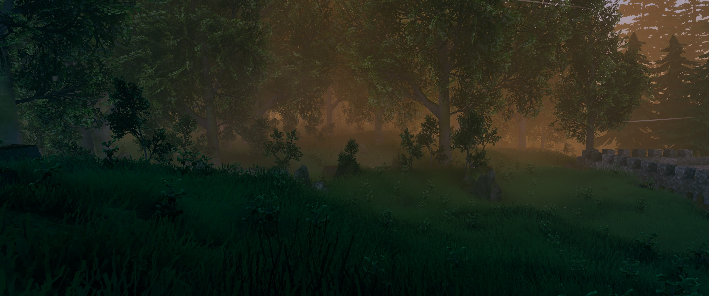
