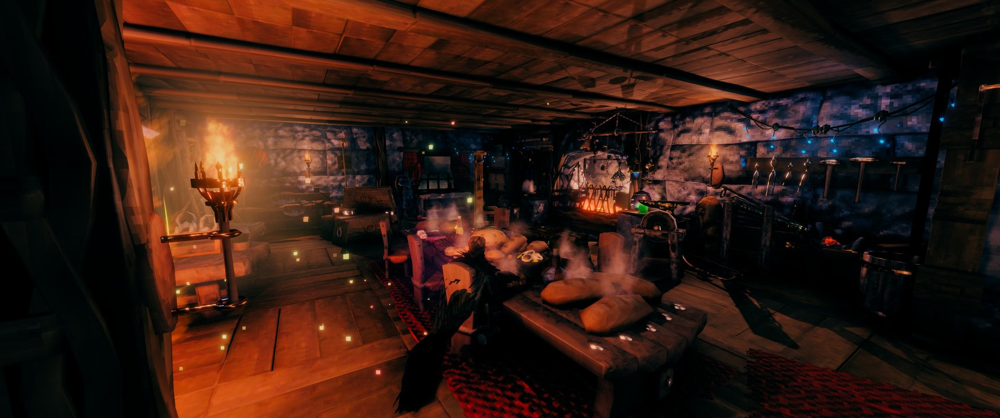
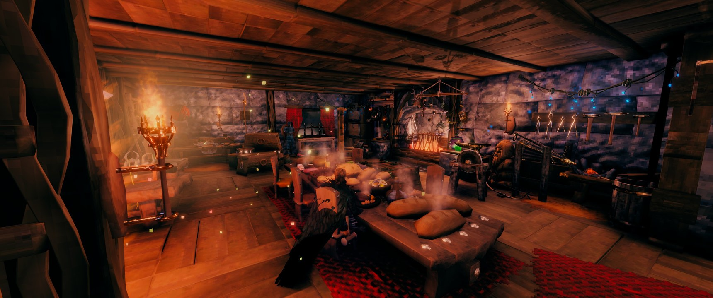

# Wire's Shadows

Real shadows for every light you place, without the performance cost.

In vanilla Valheim only the few lights nearest you get shadows, and the game redraws those every frame. Every other sconce and torch shines straight through walls, floors and roofs. Wire's Shadows gives every placed light cached shadows instead, so your base looks right and runs about as fast as vanilla.

## Comparison

Wire's Shadows first, vanilla second.

## Features

* **Cached shadows for every placed light:** sconces, torches, braziers, hearths, campfires, lanterns, forges and the rest. Each light's shadow map is rendered once and only re-rendered when something near it changes (building, removing, a door opening or closing).
* **No light leaking** through walls, floors or roofs.
* **Dynamic shadows** for things that move: players, creatures, doors and gates, dropped items, and the moving parts of windmills, spinning wheels, the refinery and turrets. Only the part of a shadow map that changed is redrawn, only where that shadow can show (on screen, and lit by that light), and the further out in a light's range the moving things are, the less often (every frame close to the light, every 4th at the edge of its reach).
* **Items on stands and placed food and meads** are part of the cached shadows, and their glows (a trophy's flame, a mead) are lights of their own.
* **Loads with the loading screen:** shadows are built while it's up and finished before it fades, so none pop in after loading or teleporting.
* **What you do comes first:** placing and breaking, doors, items on stands and food update the shadows you can see before anything else.
* **The vanilla look:** Valheim's own lighting shader, rebuilt with the shadows added. Same banding, same fades, same flicker.
* Carried torches keep the game's own shadows.
* **Coloured ambient occlusion:** the game's ambient occlusion takes on the colour of the surface it lands on (GTAO multi-bounce): bright surfaces are darkened less, coloured ones keep their colour instead of going grey.

## Limitations

* **No fire wiggle.** In vanilla a fire's light shakes around a little. A cached shadow is rendered from one spot, so here the light holds still. Its brightness still flickers while the light is nearby and visible (flicker culling is adjustable in General).
* **No swaying shadows.** Banners, hanging cloth and herbs cast their shadow at rest, not moving with the wind.

## Settings

* **Enabled:** off brings back the game's own lighting and shadows.
* **Flicker culling:** on by default. Stops unnecessary brightness flicker calculations for lights beyond the configured distance or whose full light influence is off screen. Those lights hold steady brightness; nearby visible lights keep their normal flicker. Light lifetime, fades and reduced-flashing settings are preserved.
* **Flicker distance:** 15 metres by default, measured from your player. Changing this setting does not change shadow or illumination range.
* **Tiled lights:** off by default; the optional batched lighting path remains available.
* **Timing log:** off by default. What the mod's own work costs per frame, in the log every 5 seconds.
* **Debug log:** off by default. Writes what the mod does to the log; turns itself on while a benchmark runs.
* **Benchmark:** about a minute. Measures the mod against vanilla where you stand and shows the frame times, and what moving shadows, point lights and the lighting shader each cost.
* **Quick benchmark:** the mod against vanilla in about 10 seconds.

## Performance

The goal: run the same as vanilla with point lights maxed out, or slightly better, while looking much better.

On my PC (RTX 4090, i5-13600KF, 128 GB RAM), in my base of about 6,000 pieces, the latest benchmark (0.2.1) gave 16.26 ms a frame (62 fps) with the mod and 20.26 ms (49 fps) in vanilla, 4 ms a frame faster. Earlier ones there: 15.35 ms (65 fps) against 19.95 ms (50 fps), and 20.17 ms (50 fps) against 24.85 ms (40 fps). It depends on what's happening, so I can't guarantee it's always faster.

Measure it yourself: turn on Benchmark in an in-game config menu (such as Shudnal's Configuration Manager).

## Compatibility

* Client side only.
* Windows (DirectX 11). Where the shaders can't load, the game's own lighting stays.
* Works with Valheim Performance Optimizations.
* Mods that merge building pieces into bigger meshes: their meshes are left as they are.
* Mods that replace the game's lighting shader can't be used together with this one.

The ambient occlusion shader is built from Amplify Occlusion by Amplify Creations (MIT license, included in the DLL).

Disclaimer: development is AI assisted. Not fully human or AI.

Donations: [ko-fi.com/krosshair](https://ko-fi.com/krosshair)
