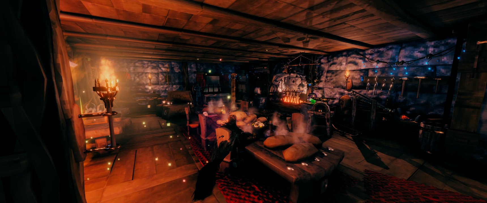
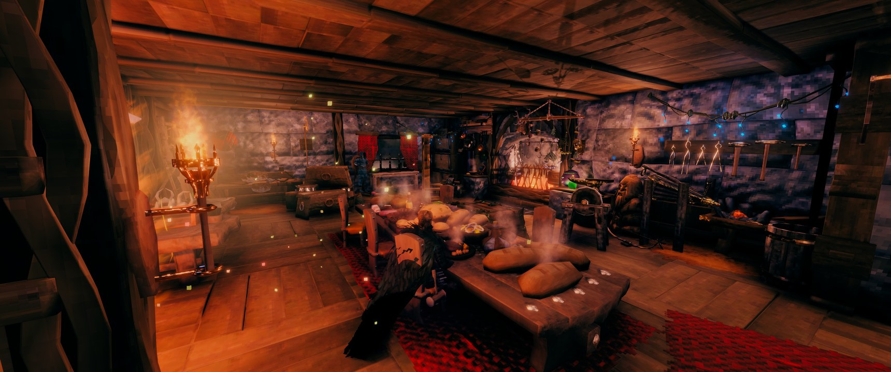

# Wire's Shadows

Real shadows for every light you place, without the performance cost.

In vanilla Valheim only the few lights nearest you get shadows, and the game redraws those every frame. Every other sconce and torch shines straight through walls, floors and roofs. Wire's Shadows gives every placed light cached shadows instead, so your base looks right and runs about as fast as vanilla.

## Comparison

Wire's Shadows first, vanilla second.

## Features

* **Cached shadows for every placed light:** sconces, torches, braziers, hearths, campfires, lanterns, forges and the rest. Each light's shadow map is rendered once and only re-rendered when something near it changes (building, removing, a door opening or closing).
* **No light leaking** through walls, floors or roofs.
* **Dynamic shadows** for things that move: players, creatures, doors and gates, dropped items, and the moving parts of windmills, spinning wheels, the refinery and turrets. Only the part of a shadow map that changed is redrawn, and the further out in a light's range the moving things are, the less often (every frame close to the light, every 4th at the edge of its reach).
* **Items on stands and placed food and meads** are part of the cached shadows, and their glows (a trophy's flame, a mead) are lights of their own.
* **The vanilla look:** Valheim's own lighting shader, rebuilt with the shadows added. Same banding, same fades, same flicker.
* Carried torches keep the game's own shadows.
* **Coloured ambient occlusion:** the game's ambient occlusion takes on the colour of the surface it lands on (GTAO multi-bounce): bright surfaces are darkened less, coloured ones keep their colour instead of going grey.

## Limitations

* **No fire wiggle.** In vanilla a fire's light shakes around a little. A cached shadow is rendered from one spot, so here the light holds still. Its brightness still flickers.
* **No swaying shadows.** Banners, hanging cloth and herbs cast their shadow at rest, not moving with the wind.

## Settings

* **Enabled:** off brings back the game's own lighting and shadows.
* **Debug log:** off by default. Writes what the mod does to the log; turns itself on while a benchmark runs.
* **Benchmark:** measures the mod against vanilla where you stand (the full mod, the mod with every moving shadow redrawn every frame, the cached shadows alone, the cached shadows with the game's own moving shadows, and vanilla) and shows the frame times.

## Performance

The goal: run the same as vanilla with point lights maxed out, or slightly better, while looking much better.

On my PC (RTX 4090, i5-13600KF, 128 GB RAM), in my base of about 6,000 pieces, one benchmark gave 17.40 ms a frame (57 fps) with the mod and 17.73 ms (56 fps) in vanilla. Other runs were up to 2.5 ms faster than vanilla. It depends on what's happening: it's faster nearly every time, but I can't guarantee it always is.

Measure it yourself: turn on Benchmark in an in-game config menu (such as Shudnal's Configuration Manager).

## Compatibility

* Client side only.
* Windows (DirectX 11). Where the shaders can't load, the game's own lighting stays.
* Works with Valheim Performance Optimizations.
* Mods that merge building pieces into bigger meshes: their meshes are left as they are.
* Mods that replace the game's lighting shader can't be used together with this one.

The ambient occlusion shader is built from Amplify Occlusion by Amplify Creations (MIT license, included in the DLL).

Disclaimer: development is AI assisted. Not fully human or AI.

Donations: [ko-fi.com/krosshair](https://ko-fi.com/krosshair)
