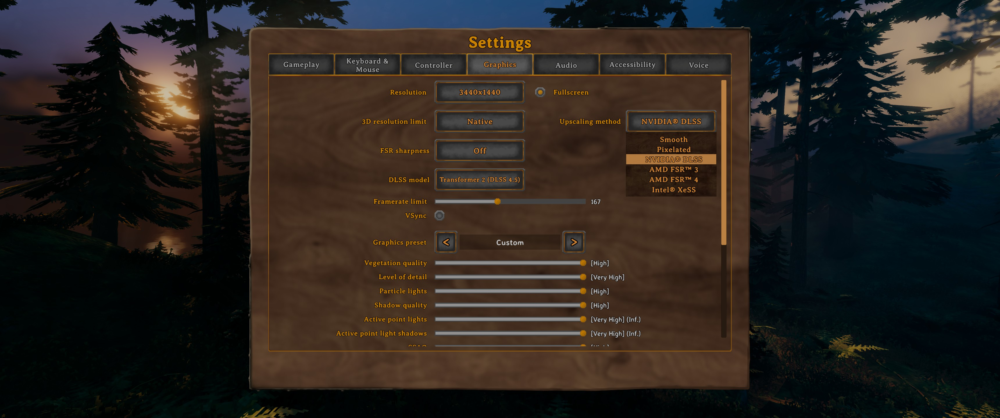
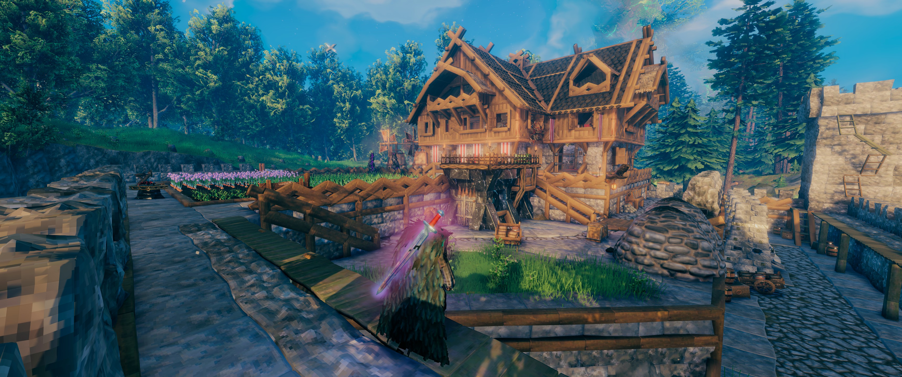
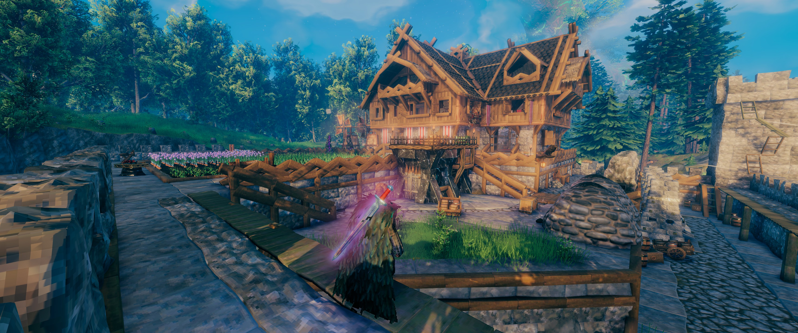

# Wire's Upscalers

NVIDIA® DLSS, AMD FSR™ and Intel® XeSS for Valheim, right in the game's own graphics settings. DLSS works with RenoDX (HDR) and ReShade as a whole, since it's on DX11. Unlike… the other mod that adds upscaling, this one has no dependencies and no additional bloated menus.

## Comparison

Native DLAA, then Valheim's own TAA.

In a still screenshot DLAA and Valheim's TAA look very alike. In game DLAA is much sharper: Valheim's TAA is good while nothing moves, and falls apart in motion and on fine detail, which a screenshot doesn't show.

## How it works

* **Settings → Graphics:** the upscalers are added to the Smooth/Pixelated row.
* **Resolution:** your game's render scale. At 100% you get the upscaler's native anti-aliasing (DLAA and the like).
* **DLSS model:** Transformer 2 (DLSS 4.5), Transformer (DLSS 4) or CNN (DLSS 3).
* **FSR sharpness:** AMD's own sharpening, off by default.

Only the upscalers your PC can run are listed:

* **NVIDIA® DLSS:** NVIDIA RTX GPUs, DirectX 11 or 12.
* **AMD FSR™ 3:** DirectX 12 only (start Valheim with `-force-d3d12`).
* **AMD FSR™ 4:** DirectX 12 and an AMD Radeon RX 9000 GPU.
* **Intel® XeSS:** DirectX 12 on any GPU, or DirectX 11 on Intel Arc.

FSR and XeSS are untested so far.

## Install

Put the whole folder in your plugins folder, not just the dll (or with a mod manager). On first launch the mod copies one file, `WiresUpscalersNative.dll`, into `valheim_Data\Plugins\x86_64`: Unity only hands its graphics device to plugins from there. Nothing else outside the mod folder is touched.

## Credits

NVIDIA, RTX and DLSS are trademarks of NVIDIA Corporation. AMD, FidelityFX and FSR are trademarks of Advanced Micro Devices, Inc. Intel and XeSS are trademarks of Intel Corporation. This mod is not affiliated with or endorsed by any of them.

Includes NVIDIA DLSS (`nvngx_dlss.dll`), AMD FSR (`amd_fidelityfx_loader_dx12.dll`, `amd_fidelityfx_upscaler_dx12.dll`) and Intel XeSS (`libxess.dll`, `libxess_dx11.dll`), unmodified, under their licences: `NVIDIA-DLSS-LICENSE.txt`, `AMD-FSR-LICENSE.txt`, `Intel-XeSS-LICENSE.txt` and `Intel-XeSS-third-party-programs.txt`.

Disclaimer: the code is AI assisted since I barely know C#. Not fully AI nor human.
https://ko-fi.com/krosshair